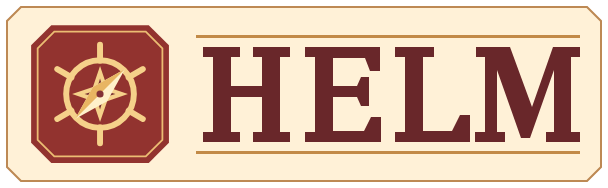

# Helm

Helm es una aplicación de Windows x64 para construir, optimizar y probar mazos de One Piece Card Game. El perfil local conserva los borradores, las versiones y las partidas de DeckLab Desktop.

## Instalar y jugar

Ejecuta **Helm-7.0.0-Setup.exe**, elige la carpeta de instalación y abre Helm desde el menú Inicio. El instalador de la beta carece de firma digital. El catálogo y las imágenes de ejemplo están incluidos. Al iniciar con conexión, Helm consulta el catálogo y las restricciones de Bandai y las referencias públicas de Limitless en segundo plano.

1. **Mesa de mazos.** Arrastra un líder a su espacio o importa una lista de texto. Debajo de tu mazo aparecen las cartas elegibles. Añade copias por arrastre, doble clic o con los botones de cada carta.
2. **Sugerir mazo.** Un clic completa 50 cartas según el líder y conserva las que ya elegiste. **Optimizar mazo** empieza desde una lista completa y busca la mejor puntuación del modelo. Puedes comparar el plan principal con propuestas de salida rápida, defensa o un rival configurado.
3. **Ajustar propuesta.** Una vez calculada, puedes limitar los cambios, establecer copias mínimas por carta, priorizar la salida, pedir más Counter +2000 o conservar la estructura. Helm recalcula con esos límites. Aplica la propuesta completa o elige sus sustituciones.
4. **Arena y Laboratorio.** Ensaya la mano inicial, cambia de rival, juega un duelo de práctica o compara dos listas con las mismas semillas. La Arena muestra el texto impreso y deja resolver manualmente las habilidades que requieren revisión.
5. **Biblioteca y Partidas.** Recupera tus versiones, consulta referencias de torneo y registra resultados de la lista y el orden de salida que jugaste.

## Datos y evidencia

El catálogo incluido se revisó el 20 de noviembre de 2026. Las 79 fichas con disponibilidad o construcción pendiente quedan fuera de las sugerencias. La actualización conserva el catálogo local si el aviso oficial de restricciones cambia y requiere revisión. El arte se busca por código, con ediciones alternativas oficiales para recuperar las imágenes que fallen. [Catálogo oficial de Bandai](https://en.onepiece-cardgame.com/cardlist/) · [Restricciones oficiales](https://en.onepiece-cardgame.com/news/restriction.html) · [Limitless](https://play.limitlesstcg.com/)

HiGHS resuelve el modelo de enteros con legalidad, colección y cantidades fijadas como restricciones. La puntuación combina probabilidades exactas de apertura, curva, Counter y sinergias interpretadas del líder. **Evidencia** muestra la cota y la brecha del modelo. El Laboratorio reporta resultados de su política de práctica por separado. [Validación de Helm 7.0](Validacion-7.0.md)

Helm es una herramienta de aficionados. Las ilustraciones y marcas del juego pertenecen a sus respectivos titulares. El timón de Helm es una marca visual original del proyecto.

## Compilar en Windows

Instala Node.js 24 y ejecuta estos comandos desde la raíz del proyecto.

~~~powershell
npm ci
npm start
npm test
npm run audit:data
npm run benchmark -- --helm
npm run build:win
npm run test:desktop -- --packaged
npm run build:installer
~~~

El instalador queda en **dist/7.0.0/Helm-7.0.0-Setup.exe**. Para verificar imágenes con conexión, ejecuta **npm run audit:data -- --online** o **node test/desktop-art.js**. Para actualizar la copia que se distribuye, usa **npm run audit:data -- --refresh** y revisa el resultado antes de compilar. La automatización de GitHub verifica código, datos y aplicación empaquetada en Windows. Los binarios de distribución se pueden adjuntar a una release privada como archivos, y quedan fuera del control de versiones.
